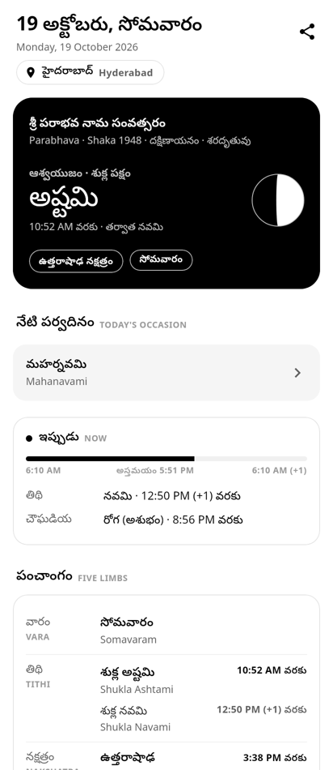
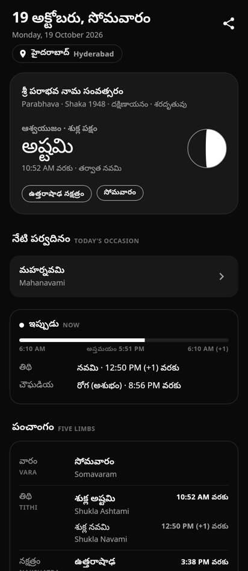
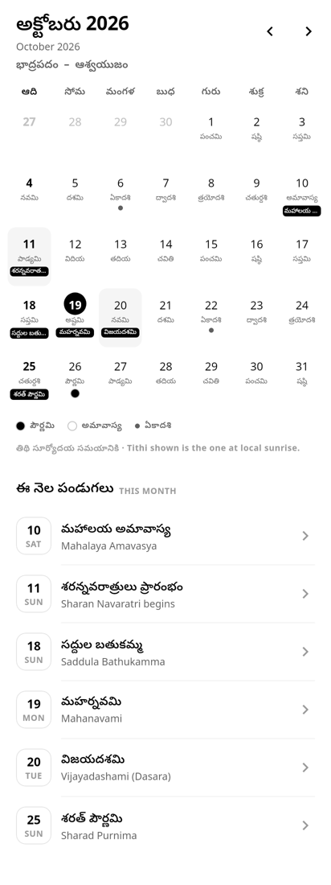
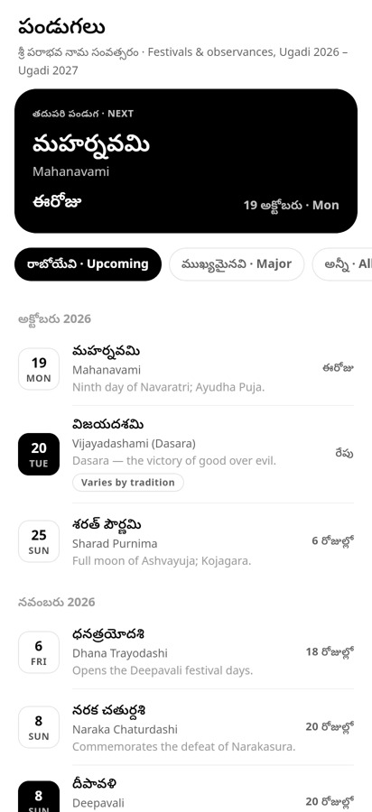

# Telugu Panchangam

A native Android Panchangam and calendar app for Telugu users, written in
Kotlin with Jetpack Compose. Daily Panchangam is computed on the phone, for
the user's city, for any date; festival dates carry per-entry citations.

The interface is monochrome: hierarchy comes from value, weight and spacing
rather than colour. Light (white page, black ink) and dark (its inverse)
themes follow the system or a user setting.

## Stack

| | |
|---|---|
| Language | Kotlin |
| UI | Jetpack Compose + Material 3 |
| Navigation | `navigation-compose` |
| Build | Gradle 9.1 / AGP 9.0.1 (built-in Kotlin) |
| Min / target SDK | 26 / 36 |

## Screens

- **నేడు · Today** — the home screen: Samvatsara, Ayana, Ritu, lunar month and
  paksha; the tithi with its end time and the next tithi; a drawn moon phase;
  a live *Now* card (current tithi, Choghadiya and any running Rahu Kalam /
  Yamagandam / Gulika, with a sunrise-to-sunrise progress bar); the five limbs
  with every transition between this sunrise and the next; sunrise, sunset,
  moonrise, moonset and day length; Brahma and Abhijit muhurtams; Rahu Kalam,
  Yamagandam and Gulika Kalam; sidereal Sun and Moon signs; day and night
  Choghadiya; upcoming festivals; share as text.
- **క్యాలెండర్ · Calendar** — swipeable months (2000–2050) with the Telugu tithi
  under each date, moon glyphs on Purnima/Amavasya, Ekadashi marks, festival
  tags, the lunar months the Gregorian month spans, and the month's festivals.
- **Day detail** — the full Panchangam for any date; swipe for the previous or
  next day.
- **పండుగలు · Festivals** — next-festival countdown, Upcoming / Major / All
  filters, month grouping, and for each festival its date note (tithi timing,
  tradition differences), verification status and sources with links.
- **మరిన్ని · More** — city (36 cities in AP, Telangana, India and the
  diaspora, with correct time zones and daylight saving), theme, 12/24-hour
  clock, method, sources and privacy.

## How the Panchangam is computed

`astro/Astronomy.kt` implements the positional astronomy from Jean Meeus,
*Astronomical Algorithms*: the Sun (ch. 25 plus the classical Venus, Jupiter
and lunar perturbation terms) and the Moon (ch. 47, ELP-2000/82 truncated).
Sidereal positions use the mean Lahiri (Chitrapaksha) ayanamsa, matching the
Swiss Ephemeris `SIDM_LAHIRI` mode.

`data/AstronomicalPanchangRepository.kt` derives from that:

- tithi, nakshatra, yoga and karana, each with start and end times;
- amanta lunar months named by the Sun's sign at the opening new moon, with
  adhika (no sankranti) and nija months detected;
- Shaka year and Samvatsara (turning at Ugadi), Ayana and Ritu;
- sunrise/sunset (upper limb, standard refraction) and moonrise/moonset;
- Rahu Kalam, Yamagandam, Gulika Kalam (eighths of daylight by weekday),
  Abhijit (8th of 15 day muhurtas), Brahma Muhurtam (14th of 15 night
  muhurtas), and day/night Choghadiya.

### Accuracy

Checked against the Swiss Ephemeris 2.10 (`pyswisseph`) for every day from
15 Mar 2026 to 20 Apr 2027 at Hyderabad, and for New York in summer and
winter time:

| Quantity | Max difference |
|---|---|
| Moon longitude | 7″ |
| Sun longitude | 7″ |
| Tithi / nakshatra / yoga end times | ~1 minute |
| Sunrise / sunset | ~1 minute |
| Moonrise / moonset | ~1.4 minutes |
| Tithi, nakshatra, yoga at sunrise | 0 mismatches in 402 days |

`app/src/test/.../AstronomicalPanchangRepositoryTest.kt` pins reference values
produced by the Swiss Ephemeris (not by this code), and checks the 2026 Adhika
Jyeshtha month and the Samvatsara change at Ugadi.

**Not included:** Varjyam, Amrita Kalam and Durmuhurtam. Their tables differ
between almanacs and were not verified for this release.

## Festival dates

`data/FestivalData.kt` covers Parabhava Samvatsara (Ugadi 19 Mar 2026 →
Ugadi 7 Apr 2027). Sources, in priority order:

1. **Sri Sringeri Sharada Peetham** — its event and announcement pages for
   the Parabhava year (sringeri.net).
2. **Governments of Andhra Pradesh and Telangana** — the 2026 general and
   optional holiday G.O.s (AP G.O.Rt.No.2276, TS G.O.Rt.No.1715).
3. **2026 Drik Panchang Hindu Calendar** (Hyderabad, Amanta, v1.0.4).

Every date was also re-checked against the computed tithi at the time of day
its rule depends on. Each festival records a status — *Verified*, *Varies by
tradition*, *Computed* or *Pending verification* — a date note, and its
sources.

Corrections made in this revision:

| Festival | Was | Now | Why |
|---|---|---|---|
| Sri Rama Navami | 26 Mar 2026 | **27 Mar 2026** | Sringeri Peetham, AP and TS G.O.s |
| Varalakshmi Vratam | 28 Aug 2026 | **21 Aug 2026** | AP and TS G.O.s (Friday before Shravana Purnima) |
| Makara Sankranti | 14 Jan 2027 | **15 Jan 2027** | Sankranti at 21:10 IST on 14 Jan, after sunset |
| Maha Shivaratri | 15 Feb 2027 | **6 Mar 2027** | Magha Bahula Chaturdashi at midnight falls on 6 Mar |

Mantra text and step-by-step ritual are not included without a cited
traditional source.

## Build

```bash
./gradlew :app:assembleDebug
./gradlew :app:testDebugUnitTest
```

The APK lands in `app/build/outputs/apk/debug/`. Set `sdk.dir` in
`local.properties` (gitignored) to your Android SDK path first.

## Screenshots

Rendered headlessly from the real Compose code (Compose Desktop, Noto Sans
Telugu), 19 Oct 2026, Hyderabad:

| Today | Today (dark) | Calendar | Festivals |
|---|---|---|---|
|  |  |  |  |
